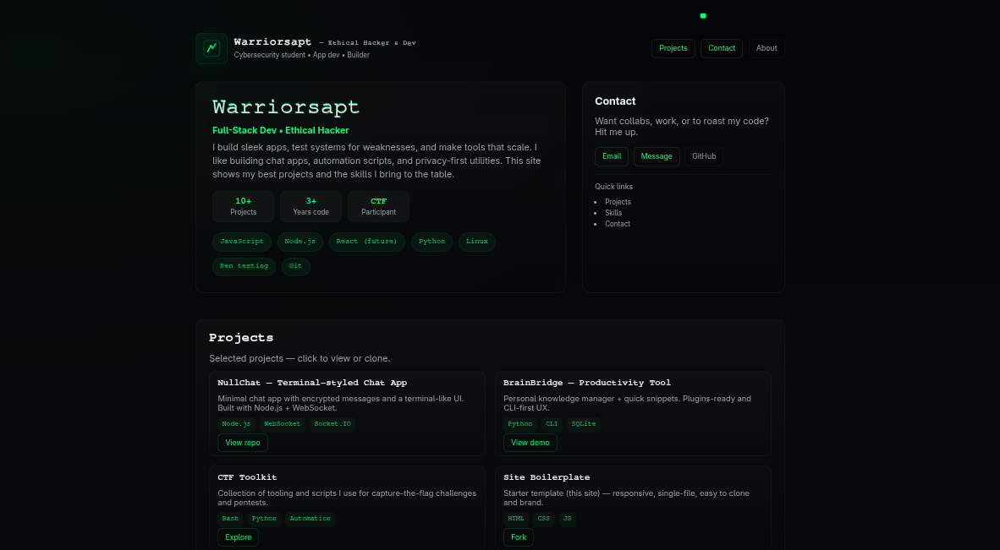

# ⚡ Warrior Portfolio Template

> Sleek hacker-themed portfolio built with pure HTML, CSS, and JavaScript — minimal setup, fast load, and responsive by design.



---

## 🧠 About
This is my personal **portfolio template** — a dark cyber aesthetic designed for developers, hackers, and tech creatives.  
It’s built as a **single-page static site** with an optional **Projects page** that auto-fetches GitHub repositories dynamically.

---

## 🚀 Features
- 🧩 **Single-file setup** — just upload and run  
- 💀 **Dark hacker aesthetic** with neon green accents  
- ⚙️ **Responsive design** (works on mobile & desktop)  
- 🔥 **Dynamic Projects page** — fetches your latest public repos via GitHub API  
- 💬 **Contact form (static)** — can be connected to Netlify Forms or Formspree  
- 🎨 **Glitch & neon cursor effects** for that cyberpunk vibe

---

## 🧱 Structure

portfolio-template/
│
├── index.html # Main landing page (About, Skills, Contact)
├── projects.html # Fetches public GitHub repos automatically
└── preview.png # Optional screenshot for README


---

## ⚡ Quick Start
### 🖥 Option 1: Local Preview
1. Clone the repo:
   ```bash
   git clone https://github.com/warriorsapt-dotcom/portfolio-template.git
   cd portfolio-template
